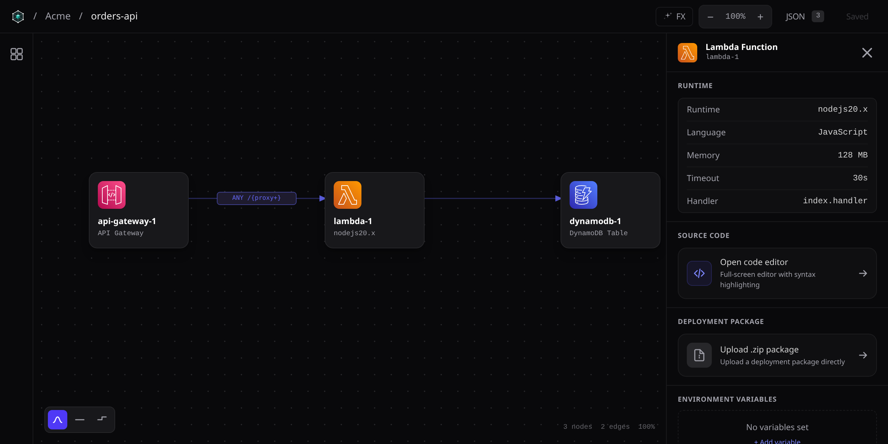
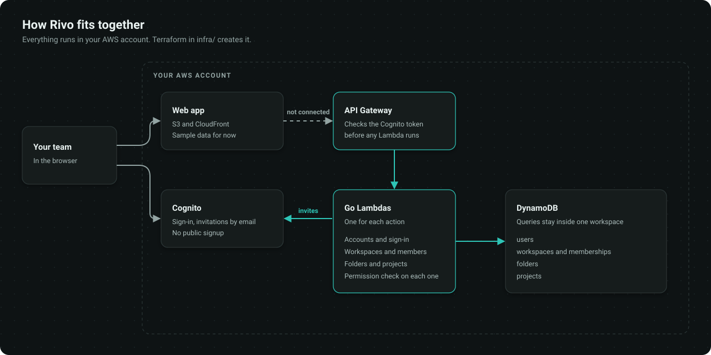

<p align="center">
  <picture>
    <source media="(prefers-color-scheme: dark)" srcset="docs/assets/logo-dark.svg">
    
  </picture>
</p>

<h1 align="center">Rivo</h1>

<p align="center">
  <strong>Your AWS infrastructure, on a canvas.</strong><br>
  Draw your architecture, organize it by team and keep it in your own AWS account.
</p>

<p align="center">
  <a href="https://github.com/Thrashy190/Rivo/releases"></a>
  <a href="https://github.com/Thrashy190/Rivo/actions/workflows/ci.yml"></a>
  <a href="LICENSE"></a>
</p>

<p align="center">
  
  
  
  
  <br>
  
  
  
  
</p>

<p align="center">
  <a href="#quick-start">Quick start</a> ·
  <a href="#accounts-and-roles">Accounts and roles</a> ·
  <a href="docs/deployment.md">Deployment</a> ·
  <a href="docs/architecture.md">Architecture</a> ·
  <a href="CONTRIBUTING.md">Contributing</a>
</p>

> **Status:** early and actively developed. You can draw, save and share diagrams with your team, and deploy them to AWS accounts you connect, after approving a plan. Six services are generated so far. See [Limitations](#limitations). The interface is English only for now.

<p align="center">
  
</p>

## What it does

**Draw your architecture**

- Drag 16 AWS services onto a canvas, including Lambda, API Gateway, EventBridge, DynamoDB, S3 and CloudFront, or start from a blueprint: a static website, a serverless API or an event-driven workflow.
- Connect them by dragging from one to another. Each line says what it does, such as `GET /items`, `read & write` or `runs`, and you can nest services inside regions, VPCs and subnets.
- Configure each service and connection in the inspector, which also says what is still missing before it can be deployed.
- Write a Lambda's code in the built-in editor, or upload its `.zip` of up to 50 MB. Both are saved with the project.
- Inspect any diagram as JSON. Use the light or dark theme, or follow your system.

**Turn it into infrastructure**

- Download Terraform generated from the diagram, with the IAM permissions each connection needs, the functions' code and a placeholder page for each website.
- It covers Lambda, API Gateway (HTTP APIs), EventBridge rules, DynamoDB, S3 and CloudFront. Other services stay in the diagram as notes, and the download lists what it left out.
- Or deploy from the app: connect an AWS account with a role Rivo assumes (no keys are stored), review the plan, approve it and follow the log. Destroying works the same way.
- Deployed services show their addresses, an API can be tested from the canvas, and every deployment is listed with its history.

**Work as a team**

- Give each company its own workspace, with folders and a team invited by email.
- Give each person the access they need: owner, editor, operator or viewer. Viewers open diagrams without being able to save them.
- Save diagrams to S3 in your account. If two people edit at once, the second one to save is asked to reload instead of overwriting the first.
- Keep companies apart: a member of one workspace cannot see that another exists.

**Stay in control**

- Everything runs in your AWS account, deployed with Terraform you can read.
- Only people you invite get an account. There is no public signup, and people who forget their password reset it with a code sent by email.
- Terraform generated by Rivo from your diagrams belongs to you.

## How it fits together

<p align="center">
  
</p>

More in [docs/architecture.md](docs/architecture.md).

## Quick start

Rivo keeps your work in your own AWS account, so you need one, plus the [prerequisites](#prerequisites). First [deploy the API](#deploy-to-aws), then run the web app on your machine against it:

```bash
git clone https://github.com/Thrashy190/Rivo.git && cd Rivo
make install

# after deploying the API
echo "RIVO_API_URL=$(terraform -chdir=infra/api output -raw api_base_url)" > web/.env.local
npm --prefix web run dev
```

Then:

1. Open **http://localhost:5173**.
2. Sign in with your `admin_email` and the temporary password Cognito emailed you, and choose your own password.
3. Create a workspace, then a project, and open the catalog with the icon on the left to drag in services.

The development server forwards `/api` to your API, so this needs no CORS settings. To host the app for your team, see [docs/deployment.md](docs/deployment.md#deploy-the-web-app).

## Prerequisites

| You need | Why | Notes |
|---|---|---|
| **Node.js 22+** | Runs and builds the web app | |
| **Go 1.27+** | Builds the Lambdas | Needed to deploy or to work on the API |
| **Terraform** | Creates the AWS resources | Tested with 1.14 |
| **An AWS account** | Runs the API and hosts the app | The resources it creates can cost money |

## Deploy to AWS

Set `admin_email` in `infra/api/environments/dev/dev.tfvars`, then:

```bash
cd infra/api
make plan ENV=dev      # builds the Lambdas and shows what will be created
make deploy ENV=dev
```

Cognito emails your first administrator a temporary password, which they replace the first time they sign in. [docs/deployment.md](docs/deployment.md) covers hosting the web app and removing everything. These steps have not been run yet from a clean AWS account in this layout, so please [report](https://github.com/Thrashy190/Rivo/issues) what you find.

## Configuration

Deployment settings live in Terraform variable files, and [docs/configuration.md](docs/configuration.md) explains each one. The one you need first:

- **`admin_email`**: a real inbox for the first administrator. Signup is closed, so this account is the only way into a new installation.
- **`web_origin`**: where you host the web app, such as `https://d1234abcd.cloudfront.net`. The browser blocks the app's calls to the API until it is set.

## Accounts and roles

Rivo has two kinds of administrator. **Platform administrators** run the installation, and **workspace owners** run their company's workspace.

| Role | Where | Can do |
|---|---|---|
| **Platform administrator** | The installation | Create accounts, administrators and workspace owners, and read every workspace |
| **Owner** | One workspace | Everything in that workspace, and invite their team with the roles below |
| **Editor** | One workspace | Change folders and projects, and run deployments |
| **Operator** | One workspace | Read, and run deployments |
| **Viewer** | One workspace | Read |

Platform administrators can only change a workspace they belong to, and each time they read one it is logged. Tell the people using your installation about this access.

## Limitations

- **Six services are generated.** The rest stay in the diagram as notes, with a warning. Sign-in with GitHub or Google is hidden until it works.
- **Deployments use the saved draft.** Versions are only in the API for now.
- **Lambda dependencies need a `.zip`.** Code written in the editor has what its runtime includes, such as boto3.
- **No screen for platform administration yet.** Accounts that can open workspaces, and other administrators, are created through the API, as in [the deployment guide](docs/deployment.md#give-someone-access). Inviting people to a workspace, and adding its owners, works in the app.
- **Access is per workspace.** Everyone in a workspace can see all its projects.
- **AWS only.** Rivo runs on AWS and designs for AWS.

What comes next is in [docs/roadmap.md](docs/roadmap.md).

## Updating

```bash
git pull
make install

cd infra/api
make plan ENV=dev
make deploy ENV=dev

cd ../..
make -C infra/web deploy
```

Each feature and fix is a [release](https://github.com/Thrashy190/Rivo/releases) with its notes, numbered with [semantic versioning](https://semver.org): `v1.2.3` is a fix over `v1.2.2`, `v1.3.0` adds something, and `v2.0.0` asks you to change something when updating.

## Troubleshooting

| Symptom | Try |
|---|---|
| `Unexpected token '<', "<!doctype"...` | The hosted app was built without `VITE_API_URL`, so it calls `/api` and gets the page instead. Deploy it with `make -C infra/web deploy`, which builds it with the API's address. |
| `Can't reach the Rivo API` | Locally, set `RIVO_API_URL` in `web/.env.local` and restart `npm run dev`. Hosted, build with `VITE_API_URL`. |
| The browser console shows a CORS error | Set `web_origin` to the exact address of the app, with no trailing slash, and apply `infra/api` again. |
| `Your account can't use Rivo yet` | The person is in Cognito but not in the `users` table, or is disabled. Create the account through the API or the app, not in the AWS console. |
| `admin_email must be a real email address` | Set a real address in your `.tfvars` file, in place of the placeholder. |
| `make plan` fails while building a Lambda | Install Go 1.27 or newer: Terraform builds the Lambdas on your machine. |
| The app asks you to choose a password | Normal the first time: invitations come with a temporary one. |
| A `.zip` upload fails in `npm run dev` | The bucket allows uploads from `dev_web_origin`, `http://localhost:5173` by default. Use that port, or set the variable and apply `infra/api` again. |
| The reset code or the invitation never arrives | Check spam. Cognito sends from `no-reply@verificationemail.com` and, without your own email service, about 50 emails a day. Someone who never signed in uses the temporary password from their invitation instead of a reset. |
| `missing permission: ...` | That role cannot do this. See [Accounts and roles](#accounts-and-roles). |
| `workspace not found`, and it exists | You are not a member. Ask its owner for an invitation. |
| `only a platform administrator can add a workspace owner` | Owners can invite editors, operators and viewers. New owners come from a platform administrator. |
| `a workspace needs at least one owner` | Add the new owner before removing the old one. |
| `Someone else saved this diagram after you opened it` | Reload to see their version. Your unsaved changes are lost, so copy anything you need from the JSON view first. |
| You are signed out after a while | Sessions last 30 days. Sign in again. |

## Development

```bash
make check                        # lint, tests and build: the same as CI
npm --prefix web run dev          # the web app, against RIVO_API_URL in web/.env.local
npm --prefix web run storybook    # components on :6006
```

The web app is in `web/`, the Lambdas in `services/` and the Terraform in `infra/`. [docs/services.md](docs/services.md) explains how to add a Lambda, and [CONTRIBUTING.md](CONTRIBUTING.md) how to send a change. To report a security problem, see [SECURITY.md](SECURITY.md).

## Responsible use

Rivo creates resources in your AWS account, and you pay AWS for them. Review what Terraform plans to create before you apply it. If you run Rivo for other people, you are responsible for their data, and your administrators can read their workspaces.

Rivo is not affiliated with or endorsed by Amazon. AWS and its service names are trademarks of Amazon.

## License

[Apache-2.0](LICENSE). Some third-party material, including the AWS icons and GSAP, keeps its own terms: see [NOTICE](NOTICE). Terraform generated by Rivo from your diagrams belongs to you.
