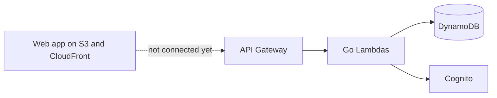

<p align="center">
  <picture>
    <source media="(prefers-color-scheme: dark)" srcset="docs/assets/logo-dark.svg">
    
  </picture>
</p>

<h1 align="center">Rivo</h1>

<p align="center">
  <strong>Design your AWS infrastructure on a canvas.</strong><br>
  Drag services, connect them and keep the result as a project your team can work on.
</p>

<p align="center">
  <a href="https://github.com/Thrashy190/Rivo/actions/workflows/ci.yml"></a>
  <a href="LICENSE"></a>
</p>

<p align="center">
  <a href="#quick-start">Quick start</a> ·
  <a href="docs/deployment.md">Deployment</a> ·
  <a href="docs/architecture.md">Architecture</a> ·
  <a href="CONTRIBUTING.md">Contributing</a>
</p>

> **Status:** early and in active development. The web app still runs on sample data in your browser, and it cannot generate Terraform or deploy yet. The API for workspaces, members and folders exists but is not connected to the web app.

## What it does

**Available in the web app, on sample data**

- Draw AWS architectures: drag services onto a canvas, connect them and nest them inside regions, VPCs and subnets.
- Configure each service from a side panel.
- Keep diagrams as projects, grouped in spaces.

**Available in the API**

- Accounts by invitation only. There is no public signup.
- Two kinds of administrator: the people who run the installation, and the owner of each workspace.
- Workspaces where owners invite their team as editors, operators or viewers.
- Folders inside a workspace.

## How it fits together



The browser app will talk to a serverless API in your AWS account. Cognito handles sign-in, and DynamoDB stores users, workspaces, memberships, folders and projects. More in [docs/architecture.md](docs/architecture.md).

## Quick start

To try the canvas on your machine you need Node.js 22 or newer. You do not need an AWS account, and any email and password work, because the app uses sample data.

```bash
git clone https://github.com/Thrashy190/Rivo.git
cd Rivo
make install
npm --prefix web run dev
```

Open the address Vite prints, usually `http://localhost:5173`, sign in with any email and open **Demo API** to see the canvas.

To run the API in your own AWS account, see [docs/deployment.md](docs/deployment.md).

## Prerequisites

| You need | Why | Notes |
|---|---|---|
| Node.js 22+ | Web app | |
| Go 1.27+ | Builds the Lambdas | Only to deploy or work on the API |
| Terraform 1.10+ | Creates the AWS resources | Only to deploy |
| An AWS account | Runs the API | Deploying creates resources that AWS can bill you for |

## Configuration

Deployment settings live in Terraform variable files. The one you need first is `admin_email`, which receives the temporary password of the first administrator. See [docs/configuration.md](docs/configuration.md).

## Development

```bash
make install        # web dependencies
make check          # everything CI runs
```

See [CONTRIBUTING.md](CONTRIBUTING.md).

## License

[Apache-2.0](LICENSE). Some third-party material, including the AWS icons, keeps its own terms: see [NOTICE](NOTICE). Terraform generated by Rivo from your diagrams belongs to you.
